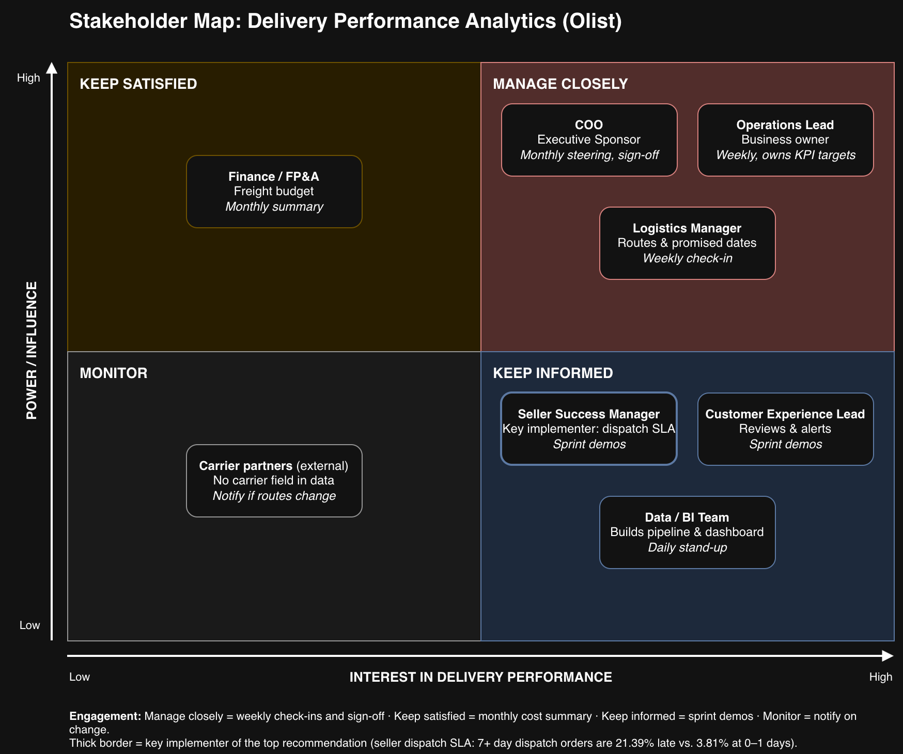

# BA Deliverable 1: Problem Statement & Stakeholder Map

*Sarika · November 2026*

## Problem statement

**6,534 of 96,470 delivered orders (6.77%) missed their promised date, by 10.62 days on average, and late orders averaged 2.27★ reviews against 4.29★ for on-time orders.** The business has no shared, trusted view of where and why deliveries fail, so teams react to complaints instead of preventing them.

| | Detail |
| --- | --- |
| **Context** | Olist connects small Brazilian sellers to large online marketplaces. Sellers ship their own orders, and customers see a promised delivery date at checkout. |
| **Current state** | On-time rate is 93.23%. Late orders run 10.62 days late on average (median 7). Performance varies widely: AL is 78.59% on time (397 orders), while SP is 95.51% (40,494). |
| **Where lateness concentrates** | Orders with 7+ days of seller dispatch are late 21.39% of the time, versus 3.81% at 0–1 days. Cross-state orders make up 76.1% of late orders. RJ produces 22.88% of late orders on 12.80% of volume. |
| **Business impact** | 62.42% of late orders receive 1–2 star reviews, versus 9.27% of on-time orders. Freight averages R$ 22.79 per order (16.63% of item value), reaching R$ 48.84 in PB. |
| **Desired state** | Operations, logistics, CX and seller teams share one automated view of delivery performance, and act first where lateness concentrates. |
| **Gap** | No agreed KPI definitions, no seller dispatch standard, and promised dates that don't reflect route or state. |

All figures are associations from the Olist data (purchases 2016-09-15 to 2018-08-29), not proven causes. No carrier field exists in the data.

## Success measures

Each measure has a verified baseline; targets are left for stakeholders to agree in the BRD rather than invented here.

| Measure | Baseline | Target | Owner |
| --- | --- | --- | --- |
| On-time delivery rate | 93.23% | To agree | Operations Lead |
| Avg. delay of late orders | 10.62 days (median 7) | To agree | Operations Lead |
| Late rate, 7+ day dispatch | 21.39% (6,503 orders) | To agree | Seller Success Manager |
| Late rate, cross-state orders | 8.03% (61,895 orders) | To agree | Logistics Manager |
| Avg. review score, late orders | 2.27★ | To agree | CX Lead |
| Freight % of item value | 16.63% | Hold or reduce | Logistics Manager + Finance |

## Stakeholder map

Source file: [stakeholder-map.drawio](stakeholder-map.drawio) (open at app.diagrams.net).

## Stakeholder register

| Stakeholder | Goals | Key question | Finding that matters most | Quadrant | Engagement |
| --- | --- | --- | --- | --- | --- |
| COO (Executive Sponsor) | Protect margin and brand reputation | Is lateness hurting customers enough to fund a fix? | Late orders: 2.27★ vs. 4.29★ | Manage closely | Monthly steering review, final sign-off |
| Operations Lead | Raise on-time rate, reduce firefighting | Which sellers, routes and states drive late orders? | 93.23% on time; cross-state = 76.1% of late orders | Manage closely | Weekly check-in, owns KPI targets |
| Logistics Manager | Faster transit without higher freight | Where should promised dates or routes change? | Cross-state 8.03% late vs. 4.52% same-state; RJ 12.11% late | Manage closely | Weekly check-in, owns route changes |
| Finance / FP&A | Accurate freight budgeting | What does each change cost? | Freight R$ 22.79/order, 16.63% of item value | Keep satisfied | Monthly summary, cost approvals |
| Seller Success Manager | Improve seller shipping behavior | Which sellers dispatch slowly, and how do we coach them? | 7+ day dispatch: 21.39% late | Keep informed | Sprint demos; owns dispatch SLA rollout |
| Customer Experience Lead | Fewer complaints, better reviews | Can we warn customers before an order is late? | 62.42% of late orders get 1–2 stars | Keep informed | Sprint demos, input on alerts |
| Data / BI Team | Reliable, tested data products | Are KPIs defined and trusted? | 90 dbt tests; 0 review mismatches | Keep informed | Daily stand-up, builds and maintains |
| Carrier partners (external) | Stable volumes and clear expectations | Will routes or volumes change? | No carrier field in the data | Monitor | Notified only if routes change |

The Seller Success Manager has lower formal power but owns the top recommendation, so treat them as a key implementer.

## RACI for the recommendations

R = Responsible, A = Accountable, C = Consulted, I = Informed.

| Recommendation | COO | Ops Lead | Logistics | Finance | Seller Success | CX Lead | Data / BI |
| --- | --- | --- | --- | --- | --- | --- | --- |
| 1. Seller dispatch SLA + scorecards | I | A | C | I | R | I | C |
| 2. Recalibrate promised dates by route/state | I | A | R | C | I | C | C |
| 3. Focused review of RJ deliveries | I | A | R | I | C | I | C |
| 4. Proactive alerts on at-risk orders | I | C | I | I | I | A/R | C |
| 5. Peak-season capacity plan | I | A | R | C | R | C | I |
| Delivery performance dashboard | I | A | C | I | C | C | R |
