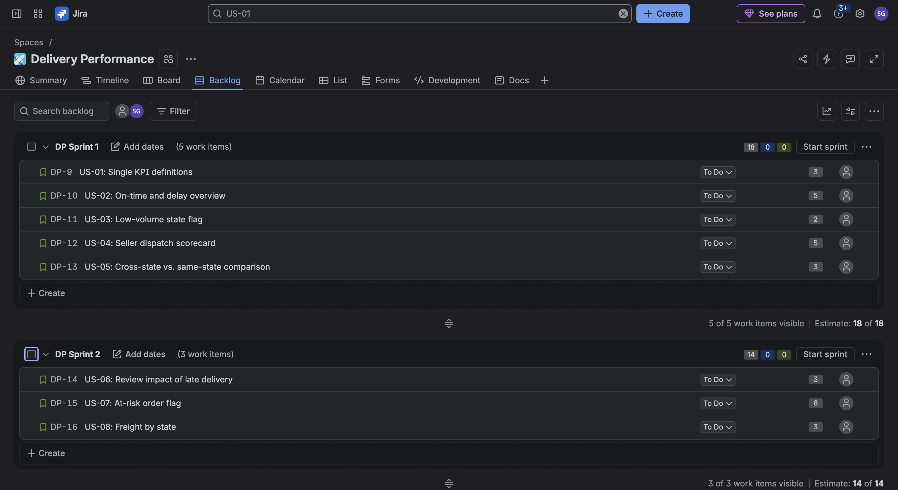

# BA Deliverable 3: User Stories & Sprint Backlog

*Sarika · November 2026*

**Eight user stories, traced to the BRD requirements, are split across two 2-week sprints: Sprint 1 delivers the Must-have foundation (18 points) and Sprint 2 the Should-haves (14 points).** Acceptance criteria use Given/When/Then and check against the verified baselines, so they double as UAT test inputs for Deliverable 6.

Jira import file: [jira-import.csv](jira-import.csv)

## Backlog overview

| Sprint | Goal | Stories | Points |
| --- | --- | --- | --- |
| Sprint 1 | One trusted view: KPI definitions, on-time overview, low-volume flag, seller scorecard, route comparison | US-01 to US-05 | 18 |
| Sprint 2 | Act on the findings: review impact, at-risk order flag, freight by state | US-06 to US-08 | 14 |
| Backlog | Not scheduled | BR-09 seasonality view; BR-10 carrier reporting (blocked: no carrier data) | — |

| Story | Title | Requirement | Priority | Points | Sprint |
| --- | --- | --- | --- | --- | --- |
| US-01 | Single KPI definitions | BR-05 | Must | 3 | 1 |
| US-02 | On-time and delay overview | BR-01 | Must | 5 | 1 |
| US-03 | Low-volume state flag | BR-04 | Must | 2 | 1 |
| US-04 | Seller dispatch scorecard | BR-02 | Must | 5 | 1 |
| US-05 | Cross-state vs. same-state comparison | BR-03 | Must | 3 | 1 |
| US-06 | Review impact of late delivery | BR-07 | Should | 3 | 2 |
| US-07 | At-risk order flag | BR-06 | Should | 8 | 2 |
| US-08 | Freight by state | BR-08 | Should | 3 | 2 |

Story points use a Fibonacci scale (1, 2, 3, 5, 8) and are relative estimates of effort, not hours.

## Sprint 1: one trusted view (18 points)

### US-01: Single KPI definitions (BR-05 · Must · 3 pts)

**As a** Data / BI analyst, **I want** each delivery KPI defined once and reused in every view, **so that** all teams see the same numbers.

- **Given** the scope of delivered orders with a delivery date, **when** the dashboard loads, **then** it covers 96,470 orders.
- **Given** an order delivered on its promised date, **when** on-time status is calculated, **then** it counts as on time (dates are compared, not timestamps).
- **Given** the KPI glossary, **when** any view shows on-time rate, delay, dispatch time or freight %, **then** it uses the glossary definition.
- **Given** the overall view, **when** it loads, **then** on-time rate shows 93.23%.

### US-02: On-time and delay overview (BR-01 · Must · 5 pts)

**As an** Operations Lead, **I want** on-time rate and average delay overall, by state and by purchase month, **so that** I can see where and when deliveries fail.

- **Given** no filters, **when** I open the overview, **then** I see on-time rate 93.23% and average delay 10.62 days (median 7).
- **Given** the state view, **when** I select AL, **then** on-time rate shows 78.59% on 397 orders.
- **Given** the state view, **when** I sort by on-time rate ascending, **then** AL, MA, SE, PI and CE appear first among states with 100+ orders.
- **Given** the month view, **when** I select November 2017, **then** the late rate shows 12.40%.

### US-03: Low-volume state flag (BR-04 · Must · 2 pts)

**As a** Data / BI analyst, **I want** states with fewer than 100 orders flagged, **so that** nobody acts on unreliable rates.

- **Given** the state view, **when** it loads, **then** RR (41), AP (67) and AC (80) carry a low-volume flag.
- **Given** a state with 100 or more orders, **when** it loads, **then** it carries no flag.
- **Given** a worst-state ranking, **when** it is shown, **then** flagged states are excluded or clearly marked.

### US-04: Seller dispatch scorecard (BR-02 · Must · 5 pts)

**As a** Seller Success Manager, **I want** a scorecard of dispatch speed and on-time rate per seller, **so that** I know which sellers to coach first.

- **Given** the scorecard, **when** it loads, **then** it lists the 804 sellers with 20+ delivered orders.
- **Given** a seller row, **when** I view it, **then** it shows order count, average dispatch days and on-time rate.
- **Given** the scorecard sorted by on-time rate ascending, **when** it loads, **then** the first seller shows 66.67% on 24 orders.
- **Given** the dispatch bands, **when** I view them, **then** late rates show 3.81% (0–1 days), 5.74% (1–3), 8.10% (3–7) and 21.39% (7+).

### US-05: Cross-state vs. same-state comparison (BR-03 · Must · 3 pts)

**As a** Logistics Manager, **I want** late rate and delivery time split by route type, **so that** I can see where promised dates need buffers.

- **Given** the route view, **when** it loads, **then** cross-state shows 61,895 orders, 8.03% late, 15.07 days average to deliver.
- **Given** the route view, **when** it loads, **then** same-state shows 34,575 orders, 4.52% late, 7.89 days.
- **Given** all late orders, **when** split by route, **then** cross-state accounts for 76.1%.

## Sprint 2: act on the findings (14 points)

### US-06: Review impact of late delivery (BR-07 · Should · 3 pts)

**As a** Customer Experience Lead, **I want** review scores compared for late vs. on-time orders, **so that** I can show leadership what lateness costs in satisfaction.

- **Given** the review view, **when** it loads, **then** late orders show 2.27★ on 6,381 reviewed orders and on-time orders show 4.29★ on 89,443.
- **Given** the review view, **when** it loads, **then** the 1–2 star share shows 62.42% for late and 9.27% for on-time orders.
- **Given** the view's caption, **when** it is read, **then** it states that the result is an association, not proof of cause.

### US-07: At-risk order flag (BR-06 · Should · 8 pts)

**As a** Customer Experience Lead, **I want** orders likely to be late flagged before their promised date, **so that** my team can contact customers early.

- **Given** an order in the 7+ day dispatch band, **when** the flag runs, **then** the order is flagged at risk.
- **Given** an order shipped cross-state, **when** the flag runs, **then** the order is flagged at risk.
- **Given** the rule is still to be agreed (BRD open question 2), **when** CX and Logistics change it, **then** the thresholds can be updated without rebuilding the view.
- **Given** historical orders, **when** the 7+ day rule is back-tested, **then** flagged orders show a 21.39% late rate.

### US-08: Freight by state (BR-08 · Should · 3 pts)

**As a** Finance / FP&A analyst, **I want** freight cost by state, **so that** I can budget for promised-date and routing changes.

- **Given** the freight view, **when** it loads, **then** it shows R$ 22.79 average freight per order and 16.63% of item value overall.
- **Given** the state ranking by average freight, **when** it loads, **then** PB shows R$ 48.84 (517 orders) at the top.
- **Given** RR and AC appear in the top five, **when** they are shown, **then** they carry the low-volume flag from US-03.
- **Given** the lowest-freight state, **when** shown, **then** SP shows R$ 17.33.

## Product backlog (not scheduled)

| Item | Requirement | Priority | Status |
| --- | --- | --- | --- |
| Seasonality view with peak periods highlighted | BR-09 | Could | Ready for a future sprint |
| Carrier-level performance reporting | BR-10 | Won't (this phase) | Blocked: no carrier field in the data |
| Log end-to-end pipeline run time | NFR-06 | Should | Technical task for the Data / BI team |

## Definition of Ready

- The story traces to a BRD requirement and has a named stakeholder.
- Acceptance criteria are written in Given/When/Then with expected values.
- The story is estimated and small enough to finish in one sprint.

## Definition of Done

- Every acceptance criterion passes against the verified baselines.
- All dbt data tests pass after the change.
- KPI definitions match the glossary (US-01).
- The stakeholder has reviewed it in the sprint demo.
