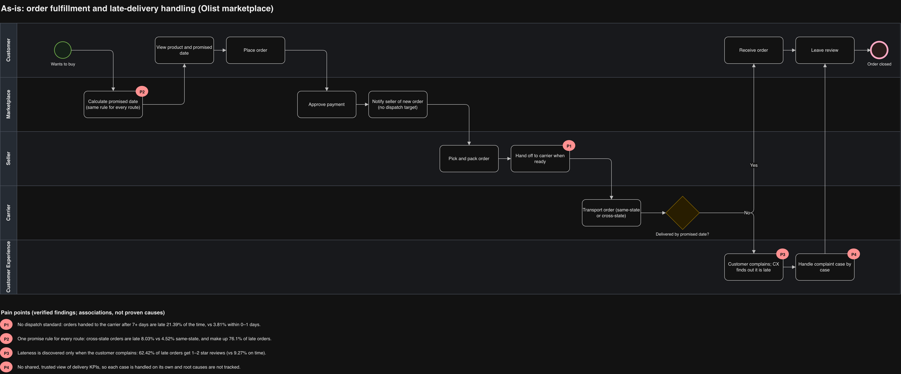
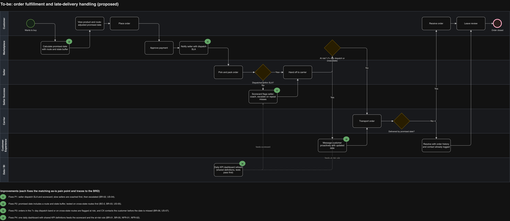

# BA Deliverable 4: As-Is and To-Be Process Maps

*Sarika · November 2026*

**Today, late deliveries are found only after the customer complains; the to-be process catches the two strongest signals (slow seller dispatch and cross-state routes) before the promised date is missed.** Both maps are BPMN-style swimlane diagrams covering order fulfillment and late-delivery handling, built in draw.io.

Source files: [as-is-process.drawio](as-is-process.drawio) · [to-be-process.drawio](to-be-process.drawio) (open at app.diagrams.net)

## As-is process

| # | Pain point | Evidence (verified finding) |
| --- | --- | --- |
| P1 | No dispatch standard for sellers | 7+ day dispatch: 21.39% late vs 3.81% at 0–1 days |
| P2 | One promised-date rule for every route | Cross-state 8.03% late vs 4.52% same-state; cross-state = 76.1% of late orders |
| P3 | Lateness discovered only when the customer complains | 62.42% of late orders get 1–2 star reviews vs 9.27% on time |
| P4 | No shared, trusted view of delivery KPIs | Each case handled on its own; root causes not tracked |

## To-be process

| # | Improvement | Fixes | Traces to |
| --- | --- | --- | --- |
| I1 | Seller dispatch SLA and scorecard; coach first, escalate on repeat misses | P1 | BO-1, BR-02, US-04 |
| I2 | Promised date includes a route and state buffer, tested on cross-state routes first | P2 | BO-2, BR-03, US-05 |
| I3 | Orders in the 7+ day dispatch band or on cross-state routes are flagged at risk; CX contacts the customer early | P3 | BO-3, BR-06, US-07 |
| I4 | One daily dashboard with shared KPI definitions feeds the scorecard and the at-risk rule | P4 | BO-4, BR-01, BR-05, NFR-01, NFR-02 |

## What changes, lane by lane

| Lane | As-is | To-be |
| --- | --- | --- |
| Customer | Sees one promised date for every route | Sees a route-adjusted promised date; hears early if an order is at risk |
| Marketplace | Approves and notifies the seller | Also sets the dispatch SLA and runs the at-risk check |
| Seller | Hands off when ready | Hands off within the SLA, or gets flagged |
| Seller Success | Not involved | Coaches sellers the scorecard flags (new lane) |
| Customer Experience | Reacts to complaints | Contacts at-risk customers proactively; resolves with context logged |
| Data / BI | Not involved | Refreshes the shared KPI dashboard daily (new lane) |

## Notes

- Findings are associations, not proven causes; the to-be changes should be piloted with a control group before scaling (see BRD risks).
- The Olist data has no carrier field, so the Carrier lane shows hand-offs only; carrier performance is out of scope (BR-10).
