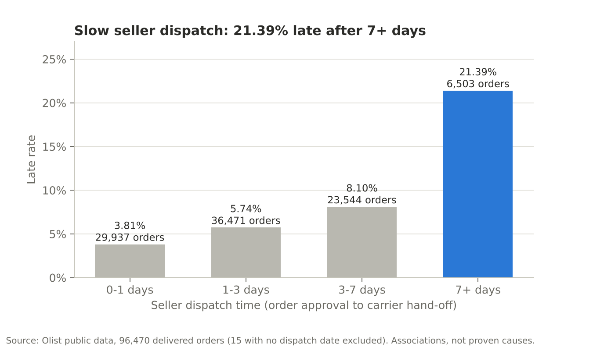
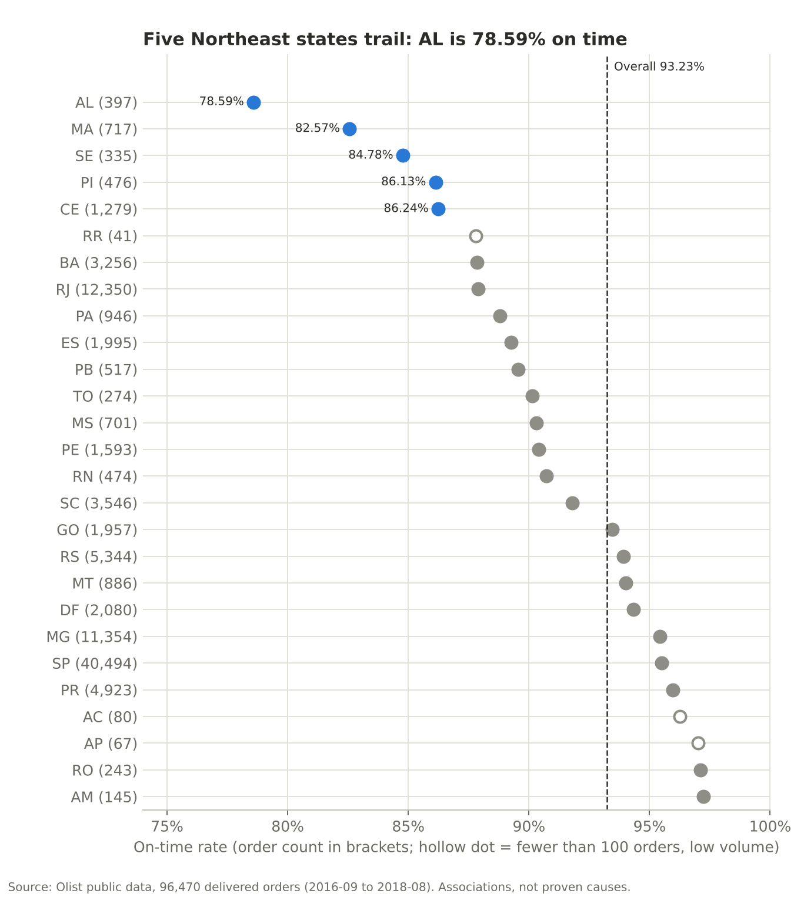
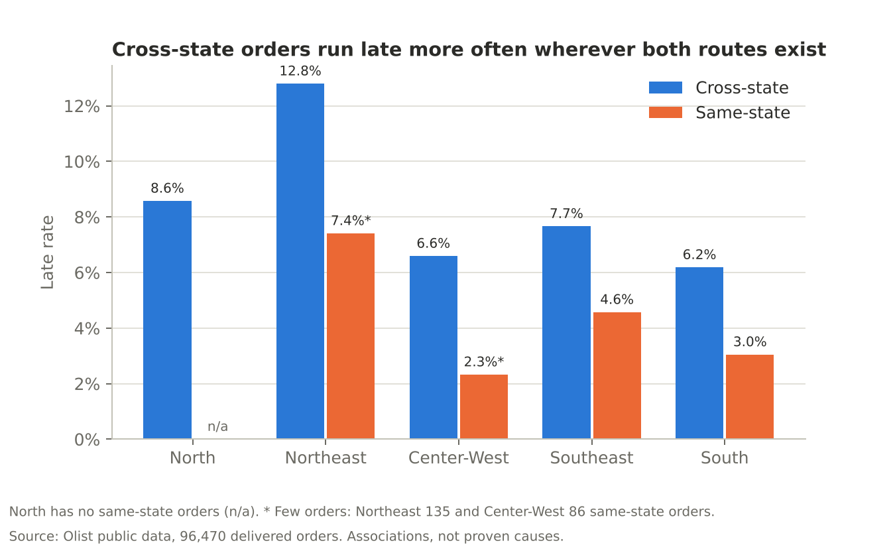
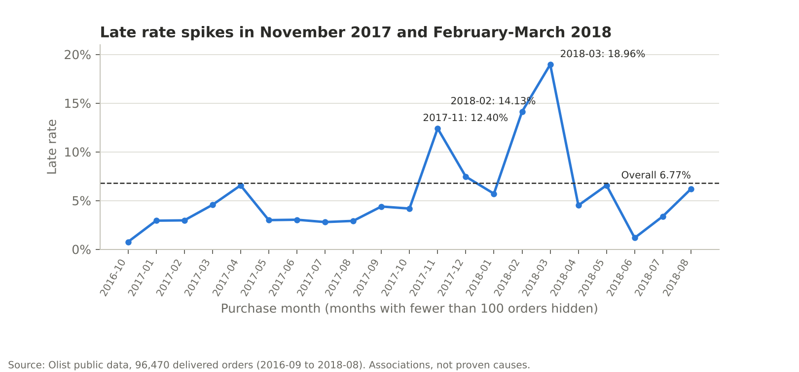

# BA Deliverable 5: Excel Analysis

*Sarika · November 2026*

**An Excel model on all 96,470 delivered orders reproduces every verified finding and sizes two options: a seller dispatch SLA lifts on-time delivery more than faster service in the five worst states, and at no freight cost.** Both scenarios are illustrative estimates on real baselines; the underlying findings are associations, not proven causes.

Workbook: [delivery-performance-analysis.xlsx](delivery-performance-analysis.xlsx). Opens in Excel 2021 / Microsoft 365 or Google Sheets; XLOOKUP columns calculate on open.

## What's in the workbook

| Sheet | What it shows | Skills demonstrated |
| --- | --- | --- |
| README | Sources, legend and a guide to every sheet | Documentation |
| Orders | 96,470 orders as an Excel table, with IF and XLOOKUP formula columns (region, seller state, seller on-time %, low-volume flag) | XLOOKUP, IF, Excel tables |
| Sellers | 2,970 sellers: orders, late orders, on-time %, average dispatch days | Lookup source |
| State_Lookup | 27 states with region, on-time %, average freight and a low-volume flag | COUNTIF, COUNTIFS, SUMIF |
| Checks | 18 workbook formulas reconciled against the verified project numbers | Data validation |
| What_If | Two scenarios, a sensitivity table and a Goal Seek exercise | What-if analysis |
| Summary_State, Summary_Dispatch, Summary_Route_Region, Summary_Monthly | Pivot-style summary tables with live COUNTIFS/SUMPRODUCT formulas and native Excel charts | Aggregation, charting |

## Data reconciliation

All 18 checks match the verified findings, including 93.23% on time, 6,534 late orders, the four dispatch-band late rates (3.81% to 21.39%), the cross-state split (8.03% vs 4.52%), review scores (2.27★ vs 4.29★), freight (R$ 22.79, 16.63% of item value) and the 804 sellers with 20+ orders.

## Key charts

The charts are rendered from the same order data as the workbook's summary sheets, so they can be viewed without Excel.

## What-if results (default inputs)

| | Scenario A: seller dispatch SLA | Scenario B: faster service in AL, MA, SE, PI, CE |
| --- | --- | --- |
| Lever | Half of the 6,503 orders in the 7+ day dispatch band move to the 3–7 day late rate (8.10%) | The five worst states reach the overall on-time rate (93.23%) |
| Late orders avoided | About 432 | About 286 |
| New on-time rate | 93.67% (+0.45 points) | 93.52% (+0.30 points) |
| Extra freight cost | None | R$ 12,696, at an assumed +10% freight (about R$ 44 per late order avoided) |
| Key assumption | 50% seller adoption in the pilot quarter | +10% freight for faster service; no carrier rate data exists |

**Sensitivity (Scenario A):** 25% adoption gives 93.45% on time, 50% gives 93.67%, 75% gives 93.90%, and 100% gives 94.12%.

**Recommendation input:** start with the dispatch SLA (Scenario A). It reaches more late orders, costs no freight, and the marketplace controls it directly. Faster service in the worst states is a second step, once real carrier quotes replace the assumed uplift.

## Limitations

- What-if figures assume an order's late rate follows its dispatch band or state target; drivers overlap, so the real effect should be confirmed with a pilot and a control group.
- Scenario B replaces the original "switch carriers" idea because the data has no carrier field; its cost is an assumption, not a quote.
- 15 orders have no dispatch date and fall in no dispatch band; 646 orders have no review score.
- North has no same-state orders, and the Northeast (135) and Center-West (86) same-state late rates rest on few orders.
- For orders with more than one seller (1,275), the seller columns use the seller with the highest item value; route counts an order as cross-state if any seller is in a different state.
