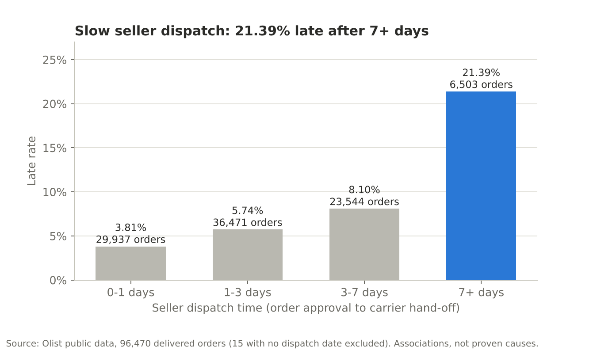

# Delivery Performance: Business Analysis Case Study

**Recommendation: fix seller dispatch first.** A dispatch SLA is estimated to avoid about 432 late orders (on-time rate 93.23% → 93.67%) at no added freight cost, more than paying for faster shipping in the five worst states (about 286 orders for about R$ 12,696 extra freight).

This repo takes my [Delivery Performance Analytics on AWS](https://github.com/sgaind-data/delivery-performance-analytics-aws) pipeline from analysis to action: problem framing, requirements, user stories, process redesign, analysis, testing and a stakeholder recommendation. It uses the public Olist Brazilian e-commerce dataset: 96,470 delivered orders purchased from 2016-09-15 to 2018-08-29.

**Live dashboard:** [Tableau Public](https://public.tableau.com/app/profile/sarika.gaind6780/viz/AWSDeliveryAnalysis/DeliveryPerformance) · **Start here:** [Case study](case-study.md) · [Stakeholder deck (PDF)](07-recommendations/stakeholder-deck.pdf)



## Key findings

- **93.23%** of orders arrive on time; the 6,534 late orders average **10.62 days** late (median 7).
- Late orders are associated with much worse reviews: **2.27★ vs 4.29★** (Welch t-test, p < 0.001, Cohen's d = −1.71); 62.42% of late orders get 1–2 stars.
- **Seller dispatch time is the strongest signal:** orders handed to the carrier after more than 7 days are late **21.39%** of the time, vs **3.81%** within a day.
- **Cross-state** orders are late 8.03% of the time (same-state: 4.52%) and make up **76.1%** of late orders.
- Location matters but explains only part of lateness (χ² p < 0.001, Cramér's V = 0.136); AL is 78.59% on time.

All findings are associations, not proven causes.

## How the deliverables connect

Each step feeds the next, and every requirement, story, test and recommendation traces back to a verified finding.

| # | Deliverable | What it does | BA skill shown |
| --- | --- | --- | --- |
| 1 | [Problem statement & stakeholder map](01-problem-statement-stakeholders/problem-statement-stakeholders.md) | Frames the problem with baselines; maps 8 stakeholders on a power/interest grid with a RACI | Problem framing, stakeholder analysis |
| 2 | [Business Requirements Document](02-brd/brd.md) | 5 objectives, scope, 10 business and 6 non-functional requirements (MoSCoW), 8 KPIs with formulas and baselines | Requirements elicitation, KPI definition |
| 3 | [User stories & backlog](03-user-stories/user-stories.md) | 8 stories with Given/When/Then acceptance criteria, 32 points across 2 Jira sprints | Agile backlog management, Jira |
| 4 | [As-is / to-be process maps](04-process-maps/process-maps.md) | BPMN-style swimlanes: 4 pain points mapped to 4 improvements | Process modeling (draw.io) |
| 5 | [Excel analysis](05-excel-analysis/excel-analysis.md) | Workbook on all 96,470 orders: XLOOKUP, summary tables, 18 reconciliation checks, two what-if scenarios | Data analysis, what-if modeling |
| 6 | [UAT test plan](06-uat-test-plan/uat-test-plan.md) | 27 test cases traced to stories; 3 real defects logged | User acceptance testing |
| 7 | [Recommendation memo](07-recommendations/recommendation-memo.md) & [deck](07-recommendations/stakeholder-deck.pdf) | Three prioritized recommendations with estimated impact, plus a pilot plan | Executive communication |

## Recommendations

| Priority | Action | Estimated impact |
| --- | --- | --- |
| 1 | Seller dispatch SLA with scorecards | About 432 late orders avoided at 50% seller adoption (216 to 864 at 25% to 100%); no freight cost |
| 2 | Early-warning alerts on 7+ day dispatch orders | Flags 6,503 orders (6.74%) that hold 1,391 late orders (21.29% of all late), so CX can act before the promise is missed |
| 3 | Faster service in AL, MA, SE, PI and CE | About 286 late orders avoided; about R$ 12,696 extra freight at an assumed +10% |

Next step: a one-quarter pilot of the dispatch SLA with a matched control group, to test cause before scaling.

## Limitations

- No carrier field exists, so carrier performance can't be separated from seller dispatch; recommendation 3's cost is an assumption.
- Drivers overlap (peak months may also slow dispatch) and no causal test was run; impact figures are estimates on real baselines.
- Low-volume states (RR 41, AP 67, AC 80 orders) are flagged wherever they appear.
- AWS resources were deleted after the project (total cost $0.00); outputs are preserved in the pipeline repo and dashboard.

## Repository layout

```
case-study.md                       one-page case study, STAR summary, interview Q&A
01-problem-statement-stakeholders/  problem statement, stakeholder register, RACI, draw.io map
02-brd/                             business requirements document
03-user-stories/                    user stories, Jira import CSV, backlog screenshot
04-process-maps/                    as-is and to-be BPMN maps (draw.io + PNG)
05-excel-analysis/                  Excel workbook, charts, write-up
06-uat-test-plan/                   UAT plan and 27-case test log
07-recommendations/                 memo and 5-slide stakeholder deck (.pptx + PDF)
```

## Tools

All free: draw.io, Excel / Google Sheets, Jira (free tier), Tableau Public, Python for data checks, Markdown on GitHub. The underlying pipeline uses Amazon S3, Redshift Serverless, dbt, Airflow and DynamoDB.

*Data: Olist Brazilian E-Commerce Public Dataset (Kaggle, CC BY-NC-SA 4.0).*
