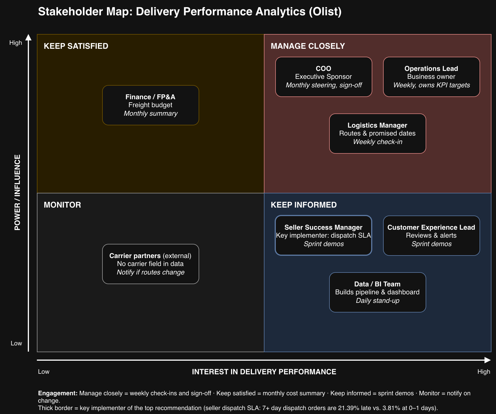

# Delivery Performance: Business Analysis Case Study

Business analysis built on my [Delivery Performance Analytics on AWS](https://github.com/sgaind-data/delivery-performance-analytics-aws) pipeline, using the public Olist Brazilian e-commerce dataset (96,470 delivered orders, purchased 2016-09-15 to 2018-08-29).

**Live dashboard:** [Tableau Public](https://public.tableau.com/app/profile/sarika.gaind6780/viz/AWSDeliveryAnalysis/DeliveryPerformance)

## Key findings
- 93.23% of orders arrived on time; late orders averaged 10.62 days late.
- Late orders averaged 2.27★ reviews vs. 4.29★ for on-time orders (Welch t-test, p < 0.001).
- Seller dispatch time is the strongest signal of lateness: 21.39% late at 7+ days of dispatch vs. 3.81% at 0–1 days.
- Cross-state orders account for 76.1% of late orders.

All findings are associations, not proven causes.

## Deliverables
| # | Deliverable | Status |
|---|---|---|
| — | [Case study](case-study.md) | Done |
| 1 | [Problem statement & stakeholder map](01-problem-statement-stakeholders/problem-statement-stakeholders.md) | Done |
| 2 | [Business Requirements Document (BRD)](02-brd/brd.md) | Done |
| 3 | [User stories & sprint backlog](03-user-stories/user-stories.md) | Done |
| 4 | [As-is / to-be process maps](04-process-maps/process-maps.md) | Done |
| 5 | [Excel analysis & what-if scenario](05-excel-analysis/excel-analysis.md) | Done |
| 6 | [UAT test plan](06-uat-test-plan/uat-test-plan.md) | Done |
| 7 | Recommendation memo & stakeholder deck | In progress |

## Tools
All free: draw.io, Google Sheets / Excel, Trello / Jira (free tier), Markdown on GitHub.
